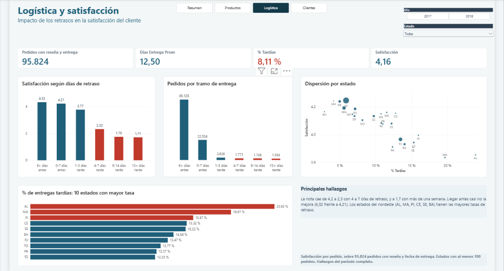
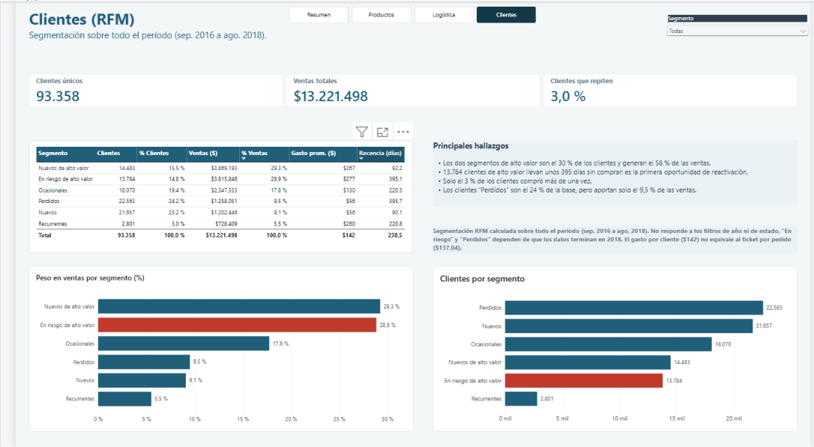

# Análisis de ventas, logística y clientes: Olist (E-commerce Brasil)

> **English summary:** End-to-end data analysis of the public Olist Brazilian e-commerce dataset (96,478 delivered orders, 2016–2018). Stack: **MySQL** (data load, views, KPIs) · **Python** (profiling, delivery delay vs. satisfaction, RFM segmentation, PDF report) · **Power BI** (DAX, 4-page dashboard) · **Excel** (pivot tables for validation). Key finding: late deliveries of 4+ days drop the average review from 4.2 to 2.3, and 30 % of customers (two high-value segments) generate 58 % of sales.

Proyecto de análisis de datos de punta a punta sobre el dataset público de Olist (Kaggle): base de datos, análisis en Python, dashboard en Power BI, Excel de apoyo y reporte ejecutivo en PDF para gerencia.

**Período analizado:** septiembre 2016 a agosto 2018 · **Pedidos entregados:** 96.478

## Entregables

| Entregable | Qué es | Dónde |
|---|---|---|
| Dashboard Power BI | 4 páginas: Resumen, Productos, Logística y Clientes | [`04_powerbi/Olist_dashboard.pbix`](04_powerbi/Olist_dashboard.pbix) |
| Reporte ejecutivo | PDF de 6 páginas para gerencia | [`05_reporte/Reporte_Olist_final.pdf`](05_reporte/Reporte_Olist_final.pdf) |
| Análisis en Python | Perfilado, retraso vs. satisfacción y RFM (Colab) | [`02_python/Analisis_Olist_Colab.ipynb`](02_python/Analisis_Olist_Colab.ipynb) |
| Excel de apoyo | Validación de cifras y tablas dinámicas | [Ver en Google Drive](https://docs.google.com/spreadsheets/d/1TVpOeDwtuy0IPPUyZ5gaXtbBlCnHl4cI/edit?usp=drive_link) |
| SQL | Carga de datos, vistas y KPIs | [`01_sql/`](01_sql) |

> **Excel:** en Google Drive se abre como Google Sheets y no muestra igual los filtros ni las tablas dinámicas. Para verlo como en Excel: Archivo → Descargar → Microsoft Excel (.xlsx).

## Objetivo
Entender qué impulsa las ventas, cómo afectan los retrasos de entrega a la satisfacción del cliente y qué segmentos de clientes concentran el valor, para apoyar decisiones de la gerencia.

## Herramientas
| Herramienta | Uso |
|---|---|
| MySQL | Carga de datos, vistas (`v_reviews_pedido`, `v_ventas`) y KPIs |
| Python (pandas, matplotlib, reportlab) | Perfilado de datos, análisis retraso vs. satisfacción, segmentación RFM y generación del reporte PDF |
| Power BI (DAX) | Modelo de datos, medidas y dashboard de 4 páginas |
| Excel (tablas dinámicas) | Validación de cifras y tablas dinámicas de apoyo |

## Indicadores principales
Pedidos entregados, calculados por pedido:

| KPI | Valor |
|---|---|
| Ventas totales (sin flete) | $13.221.498 |
| Pedidos | 96.478 |
| Ticket promedio | $137,04 |
| Días de entrega (promedio) | 12,5 |
| Entregas tardías | 8,11 % |
| Satisfacción (1-5) | 4,16 |
| Clientes únicos | 93.358 |
| Clientes que repiten | 3,0 % |

## Hallazgos destacados
- **Concentración geográfica:** SP concentra el 38 % de las ventas; SP, RJ y MG suman el 63 %.
- **Retraso y satisfacción:** la nota baja de 4,2 (entrega a tiempo) a 2,3 con 4 a 7 días de retraso y a 1,7 con más de una semana. Llegar antes casi no mejora la nota. Es una asociación, no prueba causalidad.
- **Nordeste:** AL, MA, PI, CE, SE y BA tienen las mayores tasas de entregas tardías.
- **Clientes:** los dos segmentos de alto valor son el 30 % de los clientes y generan el 58 % de las ventas. 13.784 clientes «En riesgo de alto valor» llevan unos 395 días sin comprar.
- **Recompra baja:** solo el 3 % de los clientes compró más de una vez.

## Recomendaciones para gerencia
1. **Priorizar la logística del Nordeste.** Revisar transportistas y rutas en AL, MA, PI, CE, SE y BA, donde se concentran las entregas tardías.
2. **Prometer plazos realistas.** Adelantarse casi no mejora la nota, pero retrasarse 4 días o más la hunde. Conviene agregar margen al plazo estimado en las zonas con más retrasos antes que acelerar entregas ya rápidas.
3. **Reactivar a los clientes de alto valor en riesgo.** Una campaña dirigida a los 13.784 clientes inactivos (cerca de $3,8 M históricos) tiene más potencial que captar clientes de bajo valor.
4. **Fomentar la recompra.** Con solo 3 % de recompra, programas de fidelización o cupones post-compra son una oportunidad.

## Estructura del repositorio
```
├── 01_sql/              Scripts de MySQL (carga de datos, vistas y KPIs)
├── 02_python/           Análisis en Colab (RFM, retraso) y generador del reporte PDF
├── 03_datos_procesados/ CSV generados por el análisis y usados por Power BI
├── 04_powerbi/          Dashboard (.pbix)
├── 05_reporte/          Reporte ejecutivo para gerencia (PDF)
└── imagenes/            Capturas del dashboard
```

## Vista previa del dashboard





## Cómo reproducirlo
1. Descarga el dataset original en Kaggle: *Brazilian E-Commerce Public Dataset by Olist* (los CSV originales no se incluyen en este repositorio).
2. **MySQL:** ejecuta los scripts de `01_sql/` (primero `olist_mysql_setup.sql`, ajustando la ruta de tus CSV, y luego `olist_vistas_kpis.sql`).
3. **Python:** sube los CSV originales a una carpeta de Google Drive, abre `02_python/Analisis_Olist_Colab.ipynb` en Colab y ejecuta todo. El cuaderno valida los KPIs y genera los 4 CSV de `03_datos_procesados/`.
4. **Power BI:** abre `04_powerbi/Olist_dashboard.pbix`. Si necesitas actualizar los datos, en *Transformar datos → Configuración de origen de datos* apunta cada tabla a los CSV de `03_datos_procesados/`.
5. **Reporte PDF:** abre `02_python/Reporte_Olist_Colab_final.ipynb` en Colab y ejecuta todo para generar el PDF.
6. **Excel:** descarga el archivo de apoyo desde el enlace de Drive (ver nota arriba).

## Notas metodológicas
- Los indicadores consideran solo pedidos entregados. La satisfacción es el promedio por pedido (4,16); por ítem es 4,08 y sobre todas las reseñas es 4,09.
- El Excel de apoyo excluye sep-dic 2016 en sus gráficos mensuales (267 pedidos y $40.471); los totales completos coinciden con el dashboard.
- **RFM:** recencia y monto en quintiles; frecuencia 1 pedido = 1, 2 pedidos = 3, 3 o más = 5. Se calculó sobre todo el período y depende de que los datos terminan en agosto de 2018.
- Si se eliminan o se agregan datos, los resultados cambian y el reporte debe actualizarse.

## Fuente de datos
Olist Brazilian E-Commerce Public Dataset (Kaggle). Revisa la licencia del dataset en Kaggle antes de redistribuir los datos originales. Esta carpeta `03_datos_procesados/` contiene solo tablas derivadas del análisis.

## Autor
Hans Velásquez Leres · www.linkedin.com/in/hans-navor-velásquez-leres-425b452a8 · hansnavor@gmail.com
