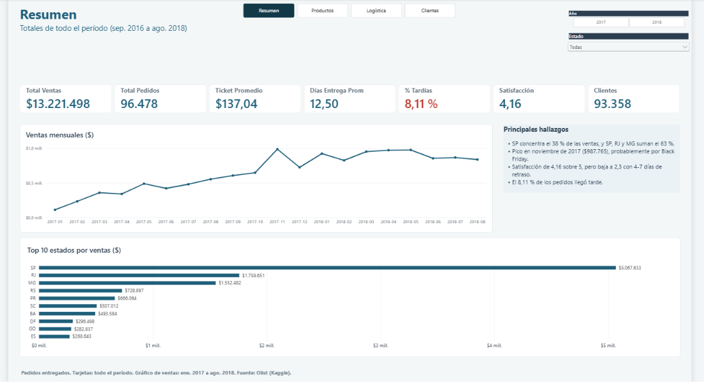

# Análisis de ventas, logística y clientes: Olist (E-commerce Brasil)

Proyecto de análisis de datos de punta a punta sobre el dataset público de Olist (Kaggle): limpieza, base de datos, análisis en Python, dashboard en Power BI, Excel de apoyo y reporte ejecutivo en PDF para gerencia.

**Período analizado:** septiembre 2016 a agosto 2018 · **Pedidos entregados:** 96.478

## Objetivo
Entender qué impulsa las ventas, cómo afectan los retrasos de entrega a la satisfacción del cliente y qué segmentos de clientes concentran el valor, para apoyar decisiones de la gerencia.

## Herramientas
| Herramienta | Uso |
|---|---|
| Excel (Power Query, tablas dinámicas) | Limpieza inicial, validación de cifras y tablas dinámicas de apoyo |
| MySQL | Carga de datos, vistas y KPIs |
| Python (pandas, matplotlib, seaborn, reportlab) | Perfilado de datos, análisis retraso vs. satisfacción, segmentación RFM y generación del reporte PDF |
| Power BI (DAX) | Modelo de datos, medidas y dashboard de 4 páginas |

## Indicadores principales
Pedidos entregados, por pedido:

| KPI | Valor |
|---|---|
| Ventas totales (sin flete) | $13.221.498 |
| Pedidos | 96.478 |
| Ticket promedio | $137,04 |
| Días de entrega (promedio) | 12,5 |
| Entregas tardías | 8,11 % |
| Satisfacción (1-5) | 4,16 |
| Clientes únicos | 93.358 |
| Clientes que repiten | 3,0 % |

## Hallazgos destacados
- **Concentración geográfica:** SP concentra el 38 % de las ventas; SP, RJ y MG suman el 63 %.
- **Retraso y satisfacción:** la nota baja de 4,2 (entrega a tiempo) a 2,3 con 4 a 7 días de retraso y a 1,7 con más de una semana. Llegar antes casi no mejora la nota. Es una asociación, no prueba causalidad.
- **Nordeste:** AL, MA, PI, CE, SE y BA tienen las mayores tasas de entregas tardías.
- **Clientes:** los dos segmentos de alto valor son el 30 % de los clientes y generan el 58 % de las ventas. 13.784 clientes «En riesgo de alto valor» llevan unos 395 días sin comprar.
- **Recompra baja:** solo el 3 % de los clientes compró más de una vez.

## Estructura del repositorio
```
├── 01_sql/          Scripts de MySQL (carga de datos, vistas y KPIs)
├── 02_python/       Cuaderno de Colab que genera el reporte PDF
├── 04_powerbi/      Dashboard (.pbix)
├── 05_reporte/      Reporte ejecutivo para gerencia (PDF)
└── imagenes/        Capturas del dashboard
```

## Vista previa del dashboard



## Cómo reproducirlo
1. Descarga el dataset en Kaggle: *Brazilian E-Commerce Public Dataset by Olist* (los CSV no se incluyen en este repositorio).
2. Ejecuta los scripts de `01_sql/` en MySQL para crear la base de datos y las vistas.
3. Abre el cuaderno de `02_python/` en Google Colab para generar el reporte PDF.
4. Abre `04_powerbi/Olist_dashboard.pbix` en Power BI Desktop para explorar el dashboard.
5. Revisa el [Excel de apoyo en Google Drive](https://docs.google.com/spreadsheets/d/1TVpOeDwtuy0IPPUyZ5gaXtbBlCnHl4cI/edit?usp=sharing), que valida las cifras clave del dashboard y muestra las tendencias mensuales y la distribución de reseñas.

> **Nota:** el archivo fue creado en Microsoft Excel (tablas dinámicas y gráficos dinámicos). Al abrirlo en Google Sheets, los filtros, las tablas dinámicas y los gráficos pueden verse distintos o incompletos. Para visualizarlo correctamente, descárgalo como archivo `.xlsx` (en Google Sheets: **Archivo > Descargar > Microsoft Excel (.xlsx)**) y ábrelo en Excel.

## Notas metodológicas
- Los indicadores consideran solo pedidos entregados. La satisfacción es el promedio por pedido (4,16); por ítem es 4,08 y sobre todas las reseñas es 4,09.
- El Excel de apoyo excluye sep-dic 2016 en sus gráficos mensuales (267 pedidos y $40.471); los totales completos coinciden con el dashboard.
- La segmentación RFM se calculó sobre todo el período y depende de que los datos terminan en agosto de 2018.
- Si se eliminan o se agregan datos, los resultados cambian y el reporte debe actualizarse.

## Fuente de datos
Olist Brazilian E-Commerce Public Dataset (Kaggle). Revisa la licencia del dataset en Kaggle antes de redistribuir los datos.

## Autor
Hans Velasquez Leres · [LinkedIn](https://www.linkedin.com/in/hans-navor-vel%C3%A1squez-leres-425b452a8) · hansnavor@gmail.com
